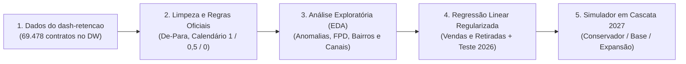
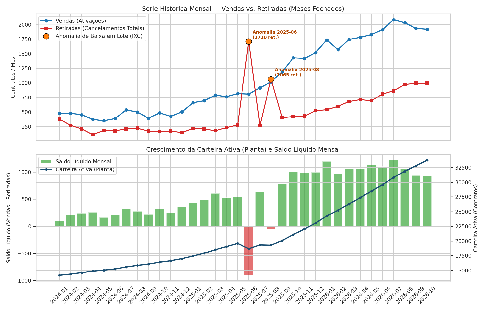
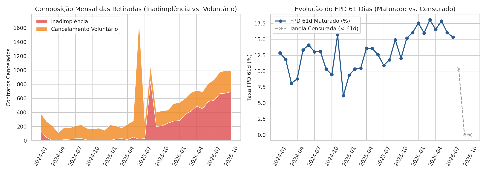
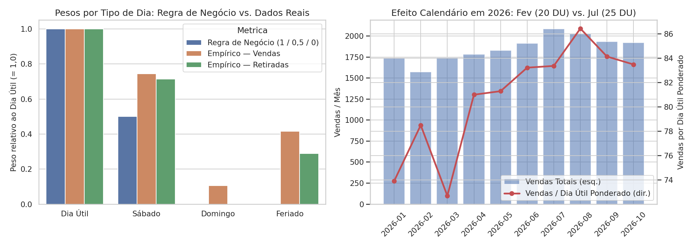
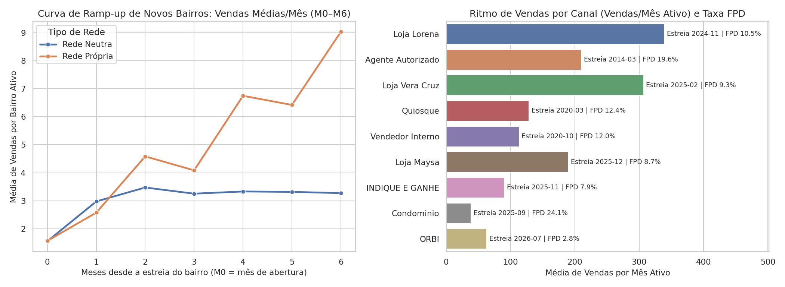
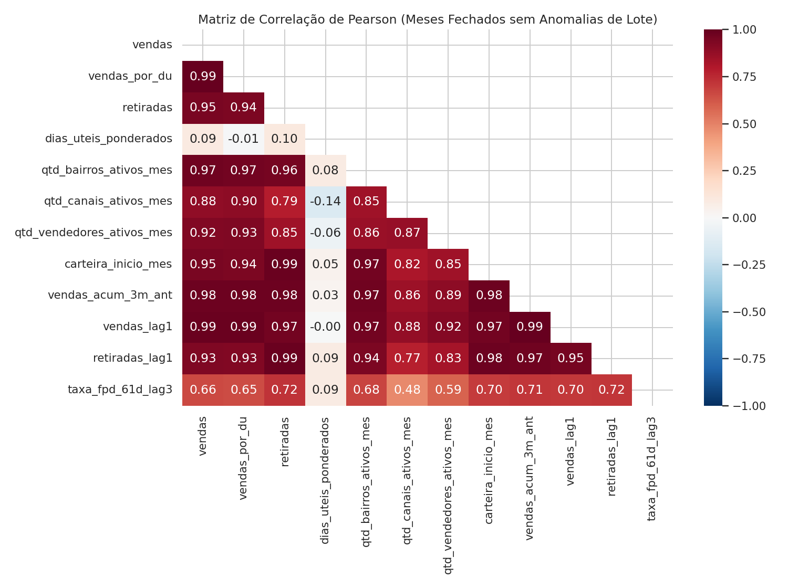
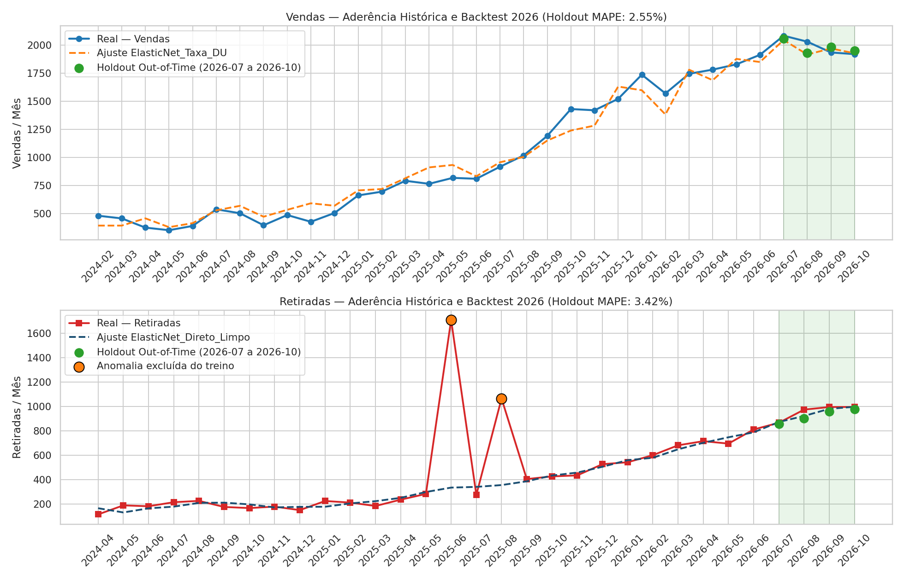
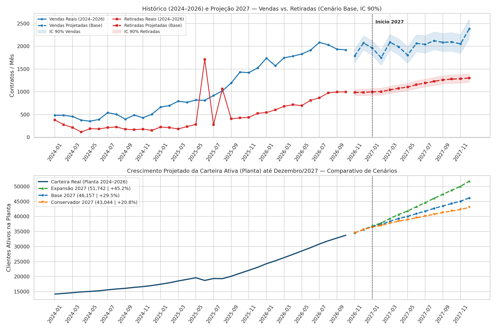
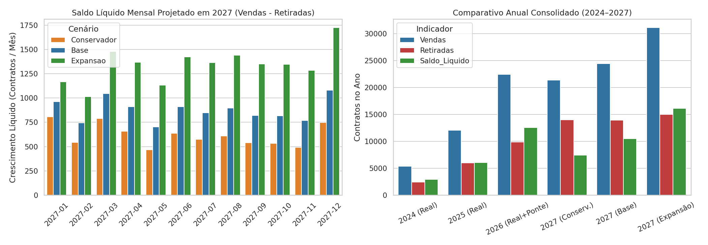

# Relatório Executivo — Projeto de Machine Learning para Projeção de Crescimento 2027

**Projeto:** `ml-retencao-forecast` (baseado nos dados do `dash-retencao` — The Fiber)  
**Data de referência dos dados:** Novembro de 2026 (meses fechados de **Jan/2024 a Out/2026**)  
**Objetivo:** Transformar o histórico operacional de vendas, cancelamentos (retiradas), FPD, bairros e canais em um **modelo estatístico transparente e auditável** para projetar **Vendas, Retiradas e Crescimento da Carteira Ativa (Planta) ao longo de 2027**.

---

## 1. Resumo Executivo (Visão Geral)

Para planejar metas comerciais, investimentos em rede e dimensionamento operacional para **2027**, construímos um projeto estruturado de Ciência de Dados e MLOps conectado diretamente ao Data Warehouse do painel **`dash-retencao`**.

Em vez de fazer projeções "no feeling" ou apenas aplicar um percentual fixo sobre o ano anterior, o modelo aprende **como a operação realmente se comporta** considerando:
- O **calendário real de 2027** (peso `1,0` para dia útil, `0,5` para sábado e `0,0` para domingo/feriado);
- A **expansão geográfica** (abertura de novos bairros em Rede Própria e Rede Neutra);
- A **estrutura comercial** (quantidade e qualidade dos canais de venda);
- A **dinâmica natural da carteira** (uma base maior de clientes ativos e vendas recentes gera, proporcionalmente, mais solicitações de cancelamento/retirada).

> **Resultado Central para 2027:** Partindo de uma carteira estimada de **35.645 clientes ativos em 01/01/2027** (após o fechamento projetado de Nov–Dez/2026), o modelo projeta que a The Fiber encerrará **Dezembro/2027** entre **43.045 clientes (+20,8%, cenário Conservador)**, **46.157 clientes (+29,5%, cenário Base)** e **51.742 clientes (+45,2%, cenário Expansão)**.

### Fluxo completo do projeto (do banco de dados à projeção 2027)

---

## 2. Origem dos Dados e Premissas de Negócio

Para que os números da projeção conversem exatamente com os relatórios que a diretoria já acompanha, o projeto lê diretamente (em modo **somente leitura**) o mesmo banco PostgreSQL do `dash-retencao` (`fato_churn_contrato` + tabelas de De-Para de canais, vendedores, bairros/redes e motivos de cancelamento).

### 2.1. Definições adotadas (alinhadas ao `dash-retencao`)

| Conceito | O que significa no projeto | Por que essa regra existe |
| :--- | :--- | :--- |
| **Venda (Ativação)** | Contrato ativado válido no mês (`flag_ativacao = 1`), excluindo vendedores marcados como teste/administrativo (`ignorar_metricas`) e `Vendedor Padrão`. | Garante que apenas vendas comerciais reais entrem na previsão. |
| **Retirada (Cancelamento)** | **Todo contrato cancelado no mês** (`flag_churn = 1`, motivos válidos), **independente da safra** (mês/ano) em que foi vendido. | Representa a perda total real de planta em cada mês, permitindo calcular o crescimento líquido da carteira. |
| **Saldo Líquido** | `Vendas - Retiradas` no mês. | Mostra quantos clientes líquidos entraram (ou saíram) da empresa naquele mês. |
| **Carteira Ativa (Planta)** | Estoque acumulado de clientes ativos (`14.082` em Dez/2023 até `33.755` em Out/2026). | É a base real de clientes que sustenta a receita e também a base exposta ao churn. |
| **FPD (61 dias)** | *First Payment Default*: clientes que não pagaram a 1ª fatura após 61 dias de atraso. | Mede a qualidade das vendas e antecede parte das retiradas por inadimplência. |
| **Corte de Mês Fechado** | O modelo treina apenas em **meses 100% fechados** (`Jan/2024` a `Out/2026` = 34 meses). `Nov/2026` fica fora do treino por estar em andamento. | Evita ensinar ao algoritmo que um mês incompleto representa uma "queda brusca" nas vendas. |

### 2.2. A Premissa de Dias Úteis Ponderados (`1,0` / `0,5` / `0,0`)

Um erro muito comum em projeções comerciais é comparar meses como se todos tivessem a mesma capacidade produtiva. Fevereiro (28 dias + Carnaval) não tem a mesma força comercial de um mês com 23 dias úteis cheios.

Por isso, construímos um **calendário operacional oficial de 2024 a 2027**, considerando feriados nacionais, estaduais de **Goiás**, municipais de **Goiânia** (Padroeira 24/05 e Aniversário 24/10) e datas de forte impacto operacional (Segunda/Terça de Carnaval e Corpus Christi), com a seguinte régua:
- **Segunda a Sexta (não feriado):** peso **`1,0`**
- **Sábado (não feriado):** peso **`0,5`**
- **Domingo ou Feriado:** peso **`0,0`**

#### Calendário Operacional de 2027 (Total anual: `273,5` dias úteis ponderados)

| Mês 2027 | Dias Corridos | Dias Úteis Cheios (`1,0`) | Sábados Úteis (`0,5`) | Domingos (`0,0`) | Feriados em Dia Útil (`0,0`) | **Dias Úteis Ponderados** |
| :--- | :---: | :---: | :---: | :---: | :---: | :---: |
| **Jan/2027** | 31 | 20 | 5 | 5 | 1 | **22,5** |
| **Fev/2027** *(Carnaval)* | 28 | 18 | 4 | 4 | 2 | **20,0** |
| **Mar/2027** | 31 | 22 | 4 | 4 | 1 | **24,0** |
| **Abr/2027** | 30 | 21 | 4 | 4 | 1 | **23,0** |
| **Mai/2027** *(Goiânia + Corpus Christi)* | 31 | 19 | 4 | 5 | 2 | **21,0** |
| **Jun/2027** | 30 | 22 | 4 | 4 | 0 | **24,0** |
| **Jul/2027** | 31 | 21 | 5 | 4 | 1 | **23,5** |
| **Ago/2027** | 31 | 22 | 4 | 5 | 0 | **24,0** |
| **Set/2027** | 30 | 21 | 4 | 4 | 1 | **23,0** |
| **Out/2027** | 31 | 20 | 5 | 5 | 1 | **22,5** |
| **Nov/2027** | 30 | 20 | 3 | 4 | 2 | **21,5** |
| **Dez/2027** | 31 | 23 | 3 | 4 | 0 | **24,5** |
| **Total 2027** | **365** | **249** | **49** | **52** | **12** | **273,5** |

---

## 3. O Que Fizemos na Análise Exploratória (EDA) — E Por Que Ela Foi Essencial

Antes de aplicar qualquer algoritmo de Machine Learning, realizamos uma **Análise Exploratória de Dados (EDA)**. Na prática, essa etapa serve para **entender a história real por trás das planilhas**: descobrir tendências, identificar distorções contábeis/operacionais e testar se nossas hipóteses de negócio realmente se confirmam nos números.

Sem a EDA, o algoritmo seria treinado "no escuro" e absorveria erros do histórico para dentro de 2027. Abaixo estão as **5 grandes descobertas** dessa investigação.

### 3.1. Evolução Histórica e Aceleração Comercial (2024–2026)

A empresa mudou completamente de patamar nos últimos 3 anos, saindo de uma média de ~450 vendas/mês em 2024 para ~1.855 vendas/mês em 2026, mais do que dobrando a planta de clientes:

| Ano (Meses Fechados) | Dias Úteis Pond. | Vendas | Retiradas Totais | Saldo Líquido | Carteira no Fim do Período | Média de Bairros Ativos/Mês | Média de Canais Ativos/Mês |
| :--- | :---: | :---: | :---: | :---: | :---: | :---: | :---: |
| **2024** (12 meses) | 274,5 | 5.393 | 2.460 | +2.933 | 17.015 | 117 | 4,6 |
| **2025** (12 meses) | 275,5 | 12.042 | 5.974 | +6.068 | 23.083 | 182 | 6,8 |
| **2026** (Jan–Out, 10m) | 229,5 | 18.547 | 7.875 | +10.672 | 33.755 | 288 | 8,3 |

### 3.2. Detecção de Anomalias de Baixa em Lote (`2025-06` e `2025-08`)

Olhando o gráfico acima, saltam aos olhos dois picos fora de padrão nas retiradas:
- **Junho/2025:** `1.710` retiradas (contra ~270–300 nos meses vizinhos);
- **Agosto/2025:** `1.065` retiradas (contra ~274 em julho e ~404 em setembro).

Ao abrir a composição por motivo (gráfico abaixo), ficou claro que esses dois meses concentraram **baixas em lote de contratos inadimplentes antigos no IXC** — um evento administrativo pontual, e não um comportamento orgânico que vai se repetir todos os meses em 2027.

> **Por que isso importa muito no modelo?** Quando testamos a Regressão Linear *sem* tratar esses dois meses atípicos, o erro de previsão das retiradas disparou de **3,42%** para **9,19%** (quase 3x pior!). Sinalizar e isolar essas duas anomalias no treino foi decisivo para a precisão do projeto.

Outro ponto fundamental descoberto no gráfico à direita foi a **censura natural do FPD 61 dias**: contratos vendidos nos últimos 2 a 3 meses (`Ago–Out/2026`) ainda não tiveram tempo de completar 61 dias após o vencimento da 1ª fatura. Por isso o índice parece "despencar para 0%" nos meses recentes. O pipeline protege automaticamente essa janela para não induzir conclusões falsas.

### 3.3. Prova Prática do Calendário Ponderado (`1 / 0,5 / 0`)

A EDA com os dados diários (mais de 1.000 dias analisados) provou duas coisas importantes:
1. **O calendário ponderado limpa falsas quedas e falsos picos:** em **Fev/2026** (`20,0` DU no Carnaval), as vendas totais caíram de `1.737` para `1.570` (-9,6%), mas dividindo pelos dias úteis ponderados, o ritmo diário na verdade **subiu** de `73,9` para `78,5` vendas/DU! Já em **Jul/2026** (`25,0` DU), o pico de `2.084` vendas ocorreu praticamente no mesmo ritmo diário de junho (`83,4` vs. `83,2` vendas/DU).
2. **Achado operacional sobre sábados e feriados:** na regra comercial padrão, o sábado vale `0,5` de um dia útil. Nos dados reais da The Fiber, o sábado entrega em média **74% das vendas** e **71% das retiradas** de um dia útil — sinal de uma operação de fim de semana bastante ativa! Já o domingo tem quase zero retiradas (`0,1%`) e baixo volume de ativações (`11%`).

### 3.4. O Ouro Estratégico: Novos Bairros (Rede Própria vs. Rede Neutra) e Novos Canais

Como a empresa saltou de `117` para `288` bairros ativos/mês e de `4` para `8–9` canais ativos, investigamos a fundo o retorno real dessas expansões:

- **Novos Bairros — Curva de Maturação (M0 a M6):**
  - **Rede Própria** (`116` bairros novos abertos em 2024–2026): começa com `1,6` vendas no mês de estreia (M0), mas **acelera consistentemente até atingir média de `9,04` vendas/mês no 6º mês**, com apenas `0,89` retiradas/mês.
  - **Rede Neutra** (`137` bairros novos): também começa em `1,6` vendas no M0, mas **estaciona cedo em torno de `3,3` vendas/mês** entre M2 e M6, chegando a `1,80` retiradas/mês no M6.
  - **Leitura de negócio:** cada novo bairro em **Rede Própria** entrega quase **3 vezes mais vendas maduras** e **metade das retiradas** de um novo bairro em Rede Neutra.
- **Novos Canais de Venda:**
  - Canais inaugurados entre o fim de 2024 e 2026 foram o grande motor da virada comercial — e com inadimplência precoce muito menor que canais legados:
    - **Loja Lorena** (estreia Nov/2024): `8.139` vendas (~`339`/mês ativo), FPD de apenas **10,5%**.
    - **Loja Vera Cruz** (estreia Fev/2025): `6.440` vendas (~`307`/mês ativo), FPD de **9,3%**.
    - **Loja Maysa** (estreia Dez/2025): `2.087` vendas (~`190`/mês ativo), FPD de **8,7%**.
    - **INDIQUE E GANHE** (estreia Nov/2025): `904` vendas, FPD baixíssimo de **7,9%**.
    - Em contraste, o canal legado **Agente Autorizado** registrou FPD de **19,6%** e alta taxa de cancelamentos.

---

## 4. Por Que Usamos Regressão Linear — E Como o Algoritmo Funciona

### 4.1. O que é Regressão Linear em linguagem simples?

A **Regressão Linear** é uma técnica estatística que encontra a **equação mais equilibrada possível** ligando causas e efeitos. Em vez de funcionar como uma "caixa-preta", ela descobre um peso numérico claro para cada fator do negócio — por exemplo: quanto cada bairro adicional soma em vendas por dia, ou quantas retiradas extras surgem a cada 1.000 novos clientes na carteira.

### 4.2. Por que Regressão Linear e não "Inteligência Artificial complexa" (Redes Neurais / Árvores Pesadas)?

Escolhemos a família de **Regressão Linear** por **3 razões técnicas e executivas bem concretas**:
1. **Adequação ao volume de meses históricos (`34 meses fechados`):** algoritmos muito complexos precisam de milhares de pontos no tempo; quando aplicados em ~34 meses, eles "decoram" o passado (*overfitting*) e erram muito ao projetar 12 meses à frente. A Regressão Linear é muito mais estável nesse cenário.
2. **Transparência total para a diretoria:** cada número projetado em 2027 pode ser auditado e explicado. Não existe resposta mágica sem justificativa.
3. **Capacidade real de simular cenários:** como bairros ativos, canais e dias úteis entram explicitamente como variáveis, conseguimos simular imediatamente o impacto de decisões de gestão em 2027.

### 4.3. Por que o vencedor foi o `ElasticNet` (Regressão Linear Regularizada)?

Na Engenharia de Atributos, testamos a correlação entre as variáveis (veja o mapa abaixo) e identificamos um fenômeno esperado em empresas que crescem rápido: **vários indicadores sobem juntos** (ex.: bairros ativos, vendas do mês anterior e tamanho da carteira). Na estatística, isso se chama *multicolinearidade*.

Quando várias causas crescem juntas, a Regressão Linear clássica (OLS) fica indecisa sobre quanto peso dar para cada variável e pode gerar coeficientes exagerados. O **`ElasticNet`** é uma evolução direta da própria Regressão Linear que adiciona um **"freio matemático" (regularização)** para distribuir os pesos com equilíbrio e zerar fatores sem utilidade real.

### 4.4. O que os dois modelos campeões aprenderam na prática

Construímos **dois modelos acoplados em cascata** (porque vendas alimentam a carteira, e a carteira alimenta as retiradas):

1. **Modelo de Vendas (`ElasticNet_Taxa_DU` — prevê vendas por dia útil ponderado e multiplica pelo calendário do mês):**
   - **Poder de explicação histórico (R²):** **97,8%** da variação histórica explicada.
   - **Pesos aprendidos (na prática):**
     - Cada **+1 bairro ativo adicional** no mês soma cerca de **+0,13 venda por dia útil** (~**+3,0 vendas/mês** diretas).
     - Cada **+1 canal de venda ativo** soma cerca de **+2,30 vendas por dia útil** (~**+53 vendas/mês** diretas, ampliadas nos meses seguintes pelo ritmo acumulado).
     - **Ritmo do mês anterior (`vendas/DU`):** peso `0,45` (captura a continuidade e inércia comercial).
     - **Calendário ponderado:** multiplica diretamente o ritmo diário pelos dias úteis ponderados do mês (garantindo que Fev/2027 e Dez/2027 respeitem fielmente seus dias úteis).

2. **Modelo de Retiradas (`ElasticNet_Direto_Limpo` — cancelamentos totais do mês, independente da safra):**
   - **Poder de explicação histórico (R²):** **98,8%** da variação histórica explicada (sem as 2 baixas em lote).
   - **Pesos aprendidos (na prática):**
     - **Tamanho da carteira ativa:** a cada **+1.000 clientes** na planta, surgem ~**+17,4 retiradas estruturais/mês**.
     - **Vendas dos últimos 3 meses (safras jovens):** a cada **+1.000 vendas** feitas no trimestre anterior, surgem ~**+52,7 retiradas** ligadas a cancelamento precoce e inadimplência inicial (FPD).
     - **Inércia do mês anterior:** peso `0,33` do volume do mês anterior.
     - **Dias úteis ponderados:** cada dia útil adicional soma ~**+5,7 retiradas** processadas no mês.

---

## 5. Prova de Confiança: Como Validamos o Modelo Antes de Projetar 2027

Para provar que o modelo não está "chutando" e nem apenas ajustando o passado, fizemos um **teste cego temporal (*Backtest Out-of-Time*)**:
- Escondemos completamente os **últimos 4 meses reais fechados de 2026 (`Julho` a `Outubro/2026`)**;
- Treinamos todos os modelos candidatos (OLS, Ridge, Lasso, ElasticNet e Huber) apenas com dados até **Junho/2026**;
- Pedimos para o modelo prever Julho, Agosto, Setembro e Outubro de 2026 e comparamos ponto a ponto com o que aconteceu na vida real.

### Resultado do Teste Real (Holdout Jul–Out/2026)

| Mês de Teste (Oculto no Treino) | Vendas Reais | Vendas Previstas | Erro Vendas (%) | Retiradas Reais | Retiradas Previstas | Erro Retiradas (%) |
| :--- | :---: | :---: | :---: | :---: | :---: | :---: |
| **Jul/2026** | 2.084 | 2.058 | -1,2% | 866 | 857 | -1,1% |
| **Ago/2026** | 2.031 | 1.931 | -4,9% | 974 | 903 | -7,3% |
| **Set/2026** | 1.935 | 1.983 | +2,5% | 995 | 960 | -3,5% |
| **Out/2026** | 1.920 | 1.951 | +1,6% | 996 | 978 | -1,8% |
| **Erro Médio Absoluto (MAPE)** | — | **51 vendas/mês** | **2,55%** | — | **33 retiradas/mês** | **3,42%** |

> **O que significa um MAPE de 2,55% em Vendas e 3,42% em Retiradas?** Em previsão de negócios, erros abaixo de 5% em testes fora da amostra são considerados **excelentes** — significam que, num mês de ~2.000 vendas, o modelo errou em média cerca de 51 contratos; num mês de ~950 retiradas, errou cerca de 33 contratos. Além disso, os testes estatísticos confirmaram que os erros são aleatórios e bem-comportados (Shapiro-Wilk *p* = 0,25 em vendas e 0,82 em retiradas; Durbin-Watson = 2,11 em retiradas).

---

## 6. Resultados: Projeção de Crescimento para 2027 (3 Cenários)

Após validados no backtest, os modelos campeões foram re-treinados com **100% dos meses fechados até Out/2026** para absorver o patamar mais recente da operação. Em seguida, projetamos os dois meses-ponte de encerramento de 2026 (`Nov/2026` e `Dez/2026`, levando a carteira de `33.755` para **35.645 clientes em 31/12/2026**) e simulamos todo o ano de **2027** sob **3 cenários estratégicos**:

### 6.1. Premissas dos 3 Cenários

| Cenário | Expansão de Bairros em 2027 | Novos Canais em 2027 | Ritmo Comercial & Retenção |
| :--- | :--- | :--- | :--- |
| **Conservador** | `+1` bairro ativo/mês (manutenção da malha) | Nenhum (`0`) | Desaceleração leve nas vendas (`-5%`) e pressão leve em retiradas (`+5%`) |
| **Base** | `+4` bairros ativos/mês (expansão orgânica) | Nenhum (`0`) | Continuidade fiel do patamar e eficiência atuais (`100%`) |
| **Expansão** | `+9` bairros ativos/mês (foco em Rede Própria) | `+1` novo canal a partir de Mar/2027 | Ganho comercial (`+8%`) e leve melhora de qualidade/retenção (`-3%` em retiradas) |

### 6.2. Quadro Executivo Consolidado — Ano Completo de 2027

| Indicador (Ano 2027 — 273,5 DU Ponderados) | Cenário Conservador | **Cenário Base** | Cenário Expansão |
| :--- | :---: | :---: | :---: |
| **Carteira Inicial (01/01/2027)** | 35.645 | **35.645** | 35.645 |
| **Total de Vendas Projetadas (2027)** | 21.377 | **24.430** | 31.106 |
| **Média Mensal de Vendas** | 1.781 / mês | **2.036 / mês** | 2.592 / mês |
| **Total de Retiradas Projetadas (2027)** | 13.977 | **13.917** | 15.008 |
| **Média Mensal de Retiradas** | 1.165 / mês | **1.160 / mês** | 1.251 / mês |
| **Saldo Líquido no Ano (Vendas − Retiradas)** | **+7.400** | **+10.513** | **+16.098** |
| **Carteira Final Projetada (31/12/2027)** | **43.045** | **46.157** | **51.742** |
| **Crescimento da Carteira em 2027** | **+20,8%** | **+29,5%** | **+45,2%** |
| **Churn Médio Mensal sobre a Carteira** | 2,97% / mês | **2,86% / mês** | 2,91% / mês |
| **Relação Retirada / Venda** | 65,4% | **57,0%** | 48,3% |

### 6.3. Detalhamento Mês a Mês de 2027 — Cenário Base

Note como o **efeito do calendário ponderado** aparece de forma natural: meses com menos dias úteis (**Fev/2027** com `20,0 DU` e **Mai/2027** com `21,0 DU`) projetam volumes menores, enquanto meses mais cheios (**Mar, Jun, Ago, Dez**) lideram as ativações. A coluna **Faixa 90% Vendas** indica o intervalo estatístico esperado considerando a margem de incerteza natural do mercado.

| Mês | DU Pond. | Bairros Ativos | Vendas Previstas | Faixa 90% Vendas | Retiradas Previstas | Saldo Líquido | Carteira Fim Mês | Churn / Carteira |
| :--- | :---: | :---: | :---: | :---: | :---: | :---: | :---: | :---: |
| **2026-11** *(Ponte)* | 21,0 | 306 | 1.787 | 1.639 – 1.935 | 983 | +804 | 34.559 | 2,91% |
| **2026-12** *(Ponte)* | 24,0 | 308 | 2.072 | 1.918 – 2.226 | 986 | +1.086 | 35.645 | 2,85% |
| **2027-01** | 22,5 | 312 | **1.961** | 1.802 – 2.121 | **997** | **+964** | 36.608 | 2,80% |
| **2027-02** | 20,0 | 316 | **1.747** | 1.582 – 1.912 | **1.003** | **+744** | 37.353 | 2,74% |
| **2027-03** | 24,0 | 320 | **2.088** | 1.918 – 2.258 | **1.041** | **+1.047** | 38.399 | 2,79% |
| **2027-04** | 23,0 | 324 | **1.987** | 1.812 – 2.163 | **1.075** | **+912** | 39.311 | 2,80% |
| **2027-05** | 21,0 | 328 | **1.805** | 1.625 – 1.985 | **1.103** | **+702** | 40.014 | 2,81% |
| **2027-06** | 24,0 | 332 | **2.064** | 1.879 – 2.249 | **1.155** | **+909** | 40.923 | 2,89% |
| **2027-07** | 23,5 | 336 | **2.040** | 1.851 – 2.230 | **1.191** | **+849** | 41.772 | 2,91% |
| **2027-08** | 24,0 | 340 | **2.122** | 1.928 – 2.316 | **1.226** | **+896** | 42.667 | 2,94% |
| **2027-09** | 23,0 | 344 | **2.084** | 1.885 – 2.283 | **1.262** | **+823** | 43.490 | 2,96% |
| **2027-10** | 22,5 | 348 | **2.095** | 1.892 – 2.298 | **1.278** | **+817** | 44.307 | 2,94% |
| **2027-11** | 21,5 | 352 | **2.052** | 1.845 – 2.260 | **1.284** | **+768** | 45.076 | 2,90% |
| **2027-12** | 24,5 | 356 | **2.384** | 2.172 – 2.596 | **1.302** | **+1.082** | **46.157** | 2,89% |
| **Total 2027 (Base)** | **273,5** | — | **24.430** | — | **13.917** | **+10.513** | **46.157** | **2,86% (méd.)** |

### 6.4. Perspectiva Histórica Anual (2024 → 2027)

| Período | Vendas | Retiradas | Saldo Líquido |
| :--- | :---: | :---: | :---: |
| **2024 (Real)** | 5.393 | 2.460 | +2.933 |
| **2025 (Real)** | 12.042 | 5.974 | +6.068 |
| **2026 (Real Jan–Out + Ponte Nov–Dez)** | 22.406 | 9.844 | +12.562 |
| **2027 — Conservador** | 21.377 | 13.977 | +7.400 |
| **2027 — Base** | **24.430** | **13.917** | **+10.513** |
| **2027 — Expansão** | 31.106 | 15.008 | +16.098 |

---

## 7. Limitações, Cuidados e Recomendações de Gestão

> **O que o modelo prevê — e o que ele não prevê sozinho:**
> Todo modelo estatístico aprende a partir das dinâmicas históricas. Eventos abruptos fora do histórico (entrada agressiva de um grande concorrente, mudança brusca de preços/planos, alteração radical na política de crédito ou novas baixas em lote no IXC) não acontecem "sozinhos" na equação — por isso trabalhamos com **3 cenários** e **faixa de confiança de 90%**.

### Recomendações práticas para 2027

1. **Priorizar expansão em Rede Própria:** a análise exploratória provou que novos bairros em Rede Própria atingem em média **9,04 vendas/mês no 6º mês** com metade do churn da Rede Neutra (**3,28 vendas/mês**). Direcionar o orçamento de expansão para Rede Própria maximiza o saldo líquido.
2. **Crescer em canais de menor FPD:** se a empresa optar pelo cenário de **Expansão (+1 novo canal em 2027)**, os dados históricos indicam maior retorno líquido em modelos com qualidade semelhante às **Lojas Próprias** (`8,7%–10,5%` FPD) e **Indique e Ganhe** (`7,9%` FPD) em vez de expandir canais terceirizados de alto FPD (~`19,6%`).
3. **Atenção ao "efeito base" nas retiradas:** mesmo mantendo o percentual de churn estável (~`2,86%/mês`), crescer a planta de `35,6k` para `46,2k` clientes faz o volume absoluto de retiradas subir naturalmente de ~`1.000` para ~`1.300`/mês até Dez/2027. Planejar a equipe de retenção e cobrança preventiva desde o 1º trimestre evita gargalos.
4. **Manter o ciclo mensal de MLOps:** todo início de mês, após o fechamento oficial no DW, basta rodar `python -m src.pipeline --step all` para atualizar os dados reais, acompanhar se o erro mensal segue abaixo de 5% e recalibrar a projeção automaticamente.

---

## 8. Glossário Rápido (Para Leitores Não Técnicos)

- **Análise Exploratória (EDA):** etapa inicial de investigação dos dados com tabelas e gráficos para entender padrões, encontrar erros e validar hipóteses antes de modelar.
- **Backtest / Holdout Out-of-Time:** teste "cego" no qual escondemos meses recentes reais do algoritmo para medir o quanto ele acerta no mundo real antes de confiar na previsão de 2027.
- **Dias Úteis Ponderados (`1 / 0,5 / 0`):** medida ajustada do calendário em que segunda a sexta vale 1 dia, sábado vale meio dia e domingos/feriados valem zero.
- **ElasticNet (Regressão Linear Regularizada):** versão moderna da Regressão Linear que evita exageros nos pesos quando várias variáveis crescem juntas no tempo.
- **FPD (61 dias):** *First Payment Default* — percentual de novos clientes que não pagam a primeira fatura em até 61 dias de atraso.
- **Intervalo de Confiança (IC 90%):** faixa provável (mínimo e máximo) onde o resultado real tende a cair 9 em cada 10 vezes, assumindo condições normais de operação.
- **MAPE (*Mean Absolute Percentage Error*):** erro percentual médio da previsão (quanto menor, melhor; abaixo de 5% é considerado excelente).
- **MLOps:** conjunto de boas práticas de engenharia para garantir que o modelo seja organizado, testável, reproduzível e fácil de atualizar todo mês.
- **R² (Coeficiente de Determinação):** indica quanto da variação histórica o modelo consegue explicar (de 0% a 100%). Nossos modelos explicaram **97,8%** das vendas e **98,8%** das retiradas.
